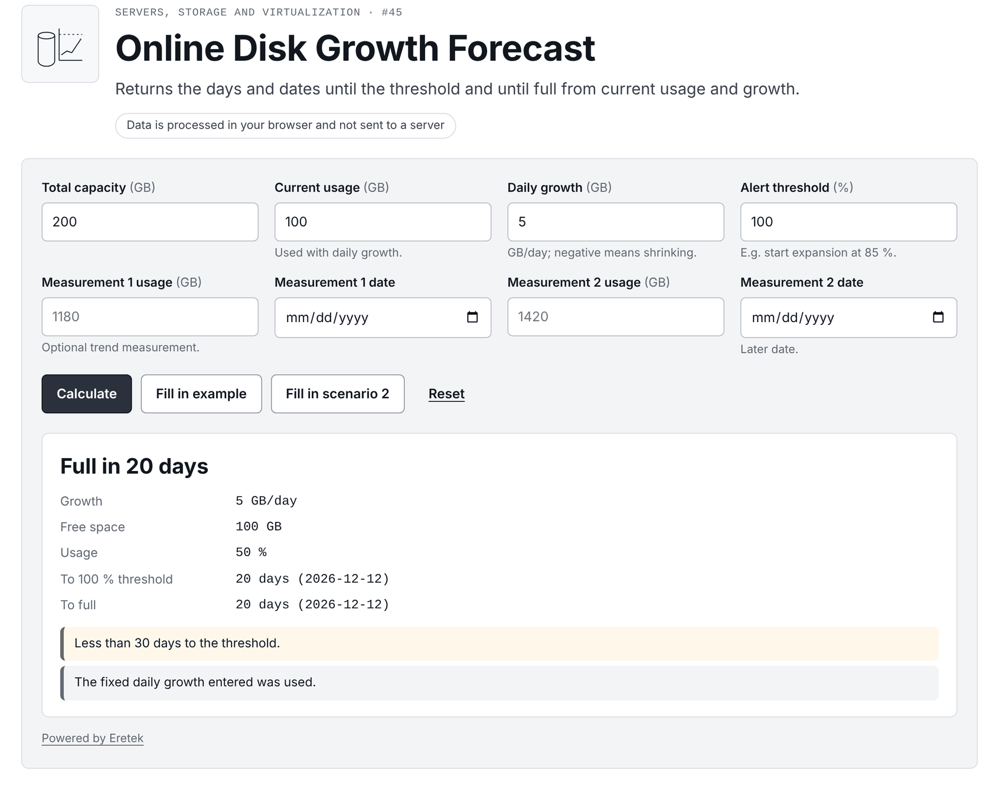

# Disk Growth Forecast

Calculate when a disk or datastore reaches the alert threshold and becomes full: daily growth or a linear trend from two dated measurements.

## Try it live

- [Türkçe](https://sistem.eretek.com/araclar/disk-doluluk-tahmini)
- [English](https://sistem.eretek.com/en/tools/disk-growth-forecast)
- [Deutsch](https://sistem.eretek.com/de/werkzeuge/speicherwachstum-prognose)



## What it does

Returns the days and dates until the threshold and until full from current usage and growth.

When a disk fills up, databases stop, VMs pause and backups fail. Purchase and delivery can take weeks, so 'when will it be full' must be known in advance. The tool forecasts with a fixed daily growth or a trend calculated from two dated measurements.

## Where it helps

If the remaining time is shorter than procurement plus installation, start expansion now. Use measurements at least two to three months apart to see spikes.

## How to use it

1. Enter total capacity.
2. Enter either current usage and daily growth, or usage at two different dates (measurements win if both are entered).
3. Enter the alert threshold and press Calculate.

### Fields

| Field | Description |
|---|---|
| Total capacity |  |
| Current usage | Used with daily growth. |
| Daily growth | GB/day; negative means shrinking. |
| Alert threshold | E.g. start expansion at 85 %. |
| Measurement 1 usage | Optional trend measurement. |
| Measurement 1 date |  |
| Measurement 2 usage |  |
| Measurement 2 date | Later date. |

## Example input

Press **Fill in example** in the tool to load this input.

| Input | Value |
|---|---|
| Total capacity | `200` |
| Current usage | `100` |
| Daily growth | `5` |
| Alert threshold | `100` |

**Expected result:** 100 GB used of 200 GB with 5 GB/day growth → full in 20 days.

## Method and assumptions

Linear model: days = (threshold − usage) / daily growth. With two measurements, growth = (u2 − u1) / days between and the start is the second measurement date.

## Limits and common mistakes

- Seasonality, month-end closing and one-off data loads are invisible in a linear model.

## Run it locally

The tool is plain HTML, CSS and JavaScript with no build step and no dependencies.

```bash
git clone https://github.com/eretek/disk-growth-forecast.git
cd disk-growth-forecast
node scripts/serve.js        # or: python3 -m http.server 8080
```

Open <http://127.0.0.1:8080/>. Add `?lang=tr` or `?lang=de` for Turkish or German; without it the page follows the browser language and falls back to English. You can also open `index.html` directly from disk.

Run the tests (Node.js 18 or later):

```bash
node test/run.js    # or: npm test
```

The tests run the tool's own fixtures and the worked examples in all three languages without a browser.

## How it works

All processing happens in your browser. The tool makes no network requests, uses no cookies or browser storage, and does not upload files you select.

No server-side component is needed. The version on the Eretek website renders the same page through a private WordPress plugin; that plugin only produces the page markup and is not part of this repository.

| Path | Purpose |
|---|---|
| `index.html` | Page shell |
| `src/app.js` | Builds the page in Turkish, English or German from `src/data.js` |
| `src/data.js` | Field definitions, examples and all texts in three languages |
| `src/core.js` | Shared runtime: validation, number formats, result rendering, CSV/ICS export |
| `src/tool.js` | The calculation or analysis for this tool |
| `docs/screenshot.png` | Screenshot used in this README |
| `src/tools.css`, `src/page.css` | Styles |
| `test/run.js`, `test/cases.json` | Headless tests |

## License and attribution

This tool is released under the [Eretek Website Attribution License](LICENSE). You may use, modify and redistribute it, including commercially. If you make it available on a website or web application, show a visible, clickable credit linking to https://eretek.com/ on every page where the tool is available, for example:

```html
<a href="https://eretek.com/">Powered by Eretek</a>
```

You may add `rel="nofollow"` to the link. Keep the copyright notice and license text in copies and redistributions.
